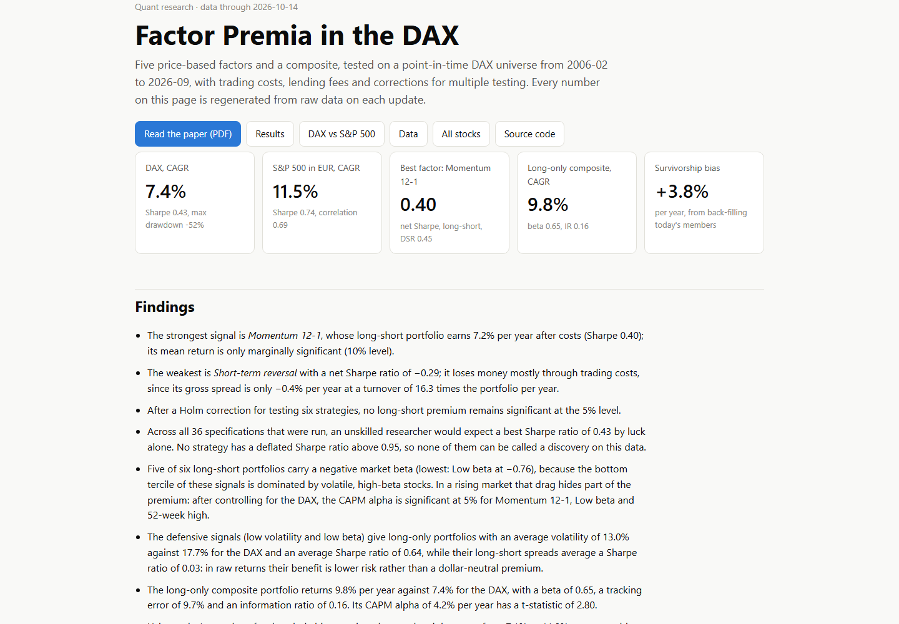
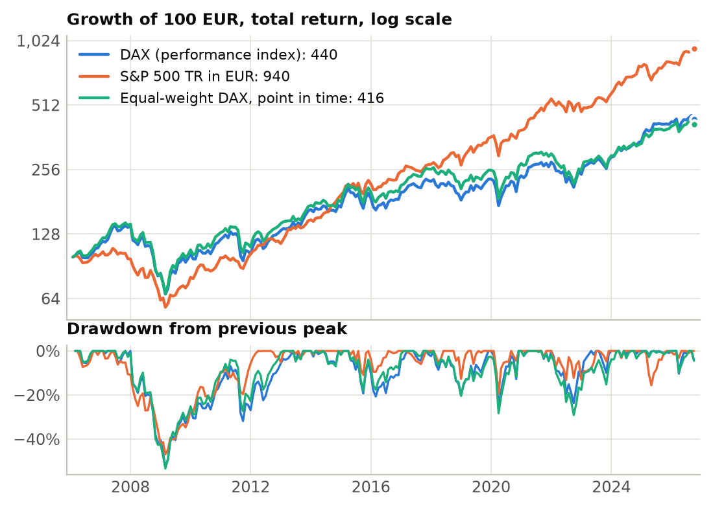
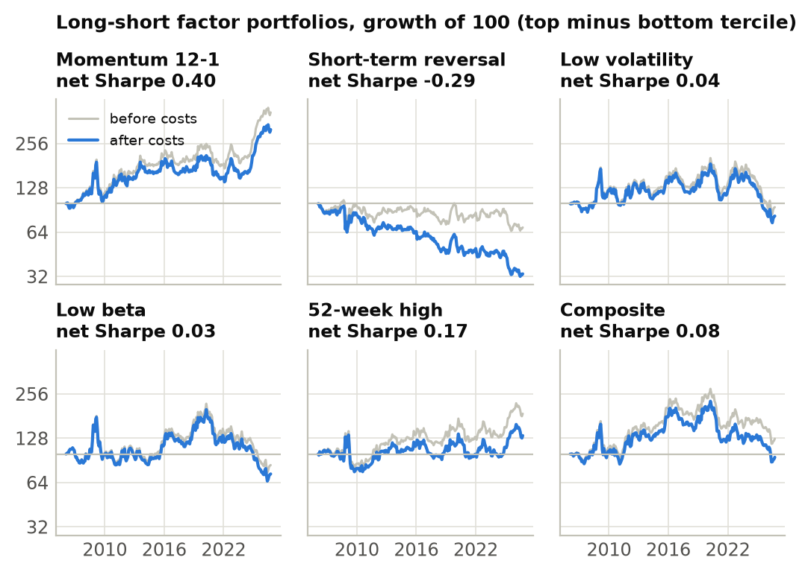

# Factor Premia in the DAX

[](https://github.com/Tristan-sketch/dax-quant-research/actions/workflows/update.yml)


[](LICENSE)

A point-in-time study of five price-based equity factors inside the DAX, benchmarked against the DAX
performance index and the S&P 500 (in euros). The project produces a LaTeX paper and a static website,
and both rebuild themselves from raw data every month.

**Live website: [tristan-sketch.github.io/dax-quant-research](https://tristan-sketch.github.io/dax-quant-research/)**
· **Paper: [PDF](https://tristan-sketch.github.io/dax-quant-research/report.pdf)**



## What makes it more than a backtest

| Problem in most hobby backtests | What this project does |
|---|---|
| Uses today's index members for the whole history (survivorship bias) | Rebuilds DAX membership for every day since 2005 from 43 documented index changes and checks that the index has exactly 30 members before 20 Sep 2021 and 40 afterwards |
| Silent data errors | Unadjusted splits, spin-off ex-dates and bad ticks are corrected explicitly and every fix is listed in the paper |
| Trades at the same close that produced the signal | Trades one day later, pays 10 bps per side plus 25 bps p.a. lending fees on shorts |
| Reports the best of many variants | Runs a 36-variant robustness grid and reports the deflated Sharpe ratio and Holm-adjusted p-values |
| Parameters tuned until it works | Factor definitions come straight from the papers and were frozen on 2026-10-14; every later month is true out-of-sample data |

## Results

The numbers change with every update, so they live in the outputs rather than in this file:

- [the website](https://tristan-sketch.github.io/dax-quant-research/) (`public/`): key figures, all charts and tables
- [the paper](https://tristan-sketch.github.io/dax-quant-research/report.pdf) (`report/main.pdf`)
- `results/*.csv`: every statistic as machine-readable tables





## Run it

Requires [uv](https://docs.astral.sh/uv/). For the PDF also [Tectonic](https://tectonic-typesetting.github.io/)
or `latexmk` (MiKTeX / TeX Live); without one, everything except the PDF still builds.

**On Windows, double-click:**

| File | What it does | Time |
|---|---|---|
| `Website_starten.bat` | Fetches the latest monthly update from GitHub (if nothing was changed locally) and opens the website | seconds |
| `Alles_aktualisieren.bat` | Downloads fresh data, reruns the whole study, rebuilds figures, paper and website, then opens it | about 2 minutes |

The website runs at `http://localhost:8765` until the console window is closed.

**From a terminal:**

```bash
uv run daxquant all      # download data, run the study, figures, paper, website
uv run daxquant serve    # open the website in the browser
uv run pytest            # 13 tests, including a look-ahead check
```

Single steps: `daxquant data`, `daxquant run`, `daxquant report [--no-pdf]`, `daxquant site`.

A local update changes the tracked output files (`results/`, `report/`, `public/`). Either commit them,
or discard them with `git checkout -- .` before pulling the next monthly update from GitHub.

## Automatic updates

`.github/workflows/update.yml` runs on the 2nd of every month, on every push to `main`, and on demand
(Actions tab, "Update research", "Run workflow"). It downloads fresh data, reruns the tests and the
study, compiles the LaTeX paper, rebuilds the website, commits the new outputs and uploads the website
as a downloadable artifact.

The paper never hard-codes a result. `src/daxquant/latex.py` writes every number as a LaTeX macro,
every table as an `\input` file, and every sentence whose meaning depends on the data (significant or
not, which factor is best) is generated from the results. An update therefore cannot leave stale text
behind.

**Hosting.** The workflow deploys `public/` to GitHub Pages on every run (repository variable
`DEPLOY_PAGES=true`, Pages source "GitHub Actions"). Any other static host works by serving `public/`.

## Project layout

```
data/reference/        hand-checked inputs: securities, index changes, corporate actions
src/daxquant/
  config.py            the frozen research specification
  data.py              downloads (Yahoo Finance, FRED) and cache
  universe.py          point-in-time DAX membership
  quality.py           return cleaning with an audit log
  signals.py           the five factor signals and the composite
  backtest.py          daily simulation with drift, turnover and costs
  metrics.py, stats.py performance measures and inference (Newey-West, PSR, DSR, Holm)
  analysis.py          the whole study in one function
  figures.py           all charts
  latex.py             numbers, tables and findings for the paper
  site.py              the website
report/main.tex        the paper
site/                  website template and stylesheet
tests/                 unit tests
```

## Reading order for learning

1. `config.py`: what is being tested and why each parameter has its value.
2. `universe.py` and `quality.py`: most of the work in real quant research is the data.
3. `signals.py` and `backtest.py`: how a signal becomes a portfolio and a return series.
4. `stats.py`: why a Sharpe ratio of 0.4 over 20 years can still be luck.
5. The paper, especially the robustness section.

## Limitations

Free data only. Seven former members (Wirecard, MAN, Altana, Schering, HypoVereinsbank, Hypo Real
Estate, Postbank) have no free price history and are missing while they were members. Dividends are
included through adjusted closes, which slightly affects the 52-week-high signal. Costs are one flat
estimate. Value and quality factors are not tested because point-in-time fundamentals are not freely
available.

This is research, not investment advice.

## License

Code under the [MIT License](LICENSE). Market data belongs to its providers (Yahoo Finance, FRED) and is not redistributed beyond the derived results.
